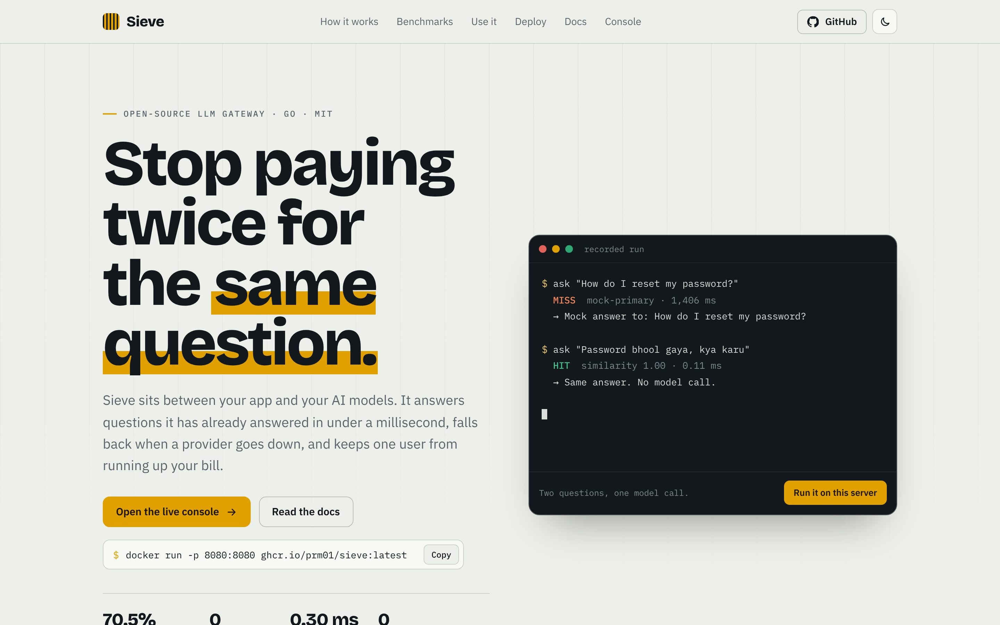
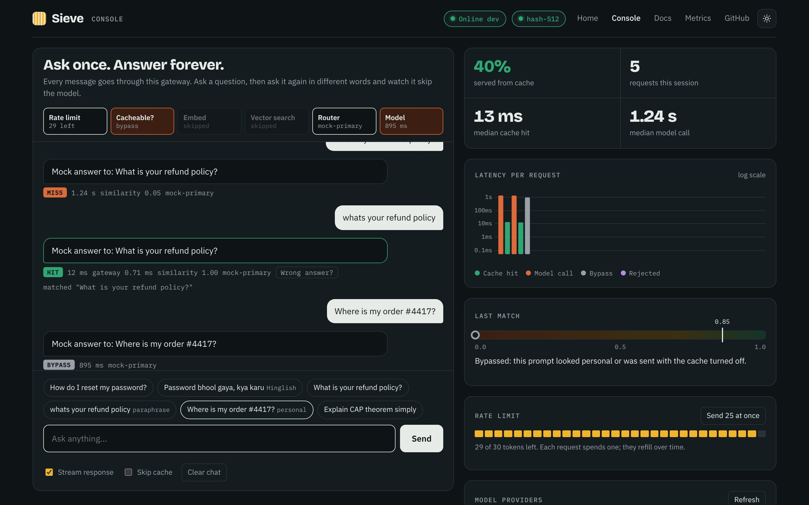
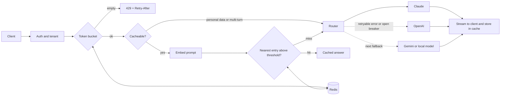

<div align="center">

# Sieve

**An open-source LLM gateway that stops you paying twice for the same question.**

Semantic caching, multi-provider fallback, rate limiting and Prometheus metrics in one Go binary with zero dependencies. Point any OpenAI SDK at it by changing one URL.

[](https://github.com/Prm01/sieve/actions/workflows/ci.yml)


[](LICENSE)

[Live demo](https://claude.ai/artifact/FbMhVEpPvKb2oTuFs9tChW) · [Quickstart](#quickstart) · [Benchmarks](#benchmarks) · [How it works](#how-it-works) · [Design decisions](docs/ARCHITECTURE.md)

</div>

<!-- Drag docs/demo.mp4 into this README on GitHub to embed the 90-second walkthrough here. -->



Every Sieve server comes with its own website at `http://localhost:8080`: a home page with a live demo and benchmark charts, a console at `/console` to chat through the gateway and watch each request, and full documentation at `/docs`.



## Why

Apps that call LLM APIs pay for the same answer again and again. "How do I reset my password?", "I forgot my password" and "password bhool gaya, kya karu" are one question, but they are three paid model calls that each take a second or more.

Sieve sits between your app and the model providers:

```
your app ──▶ Sieve ──▶ cache hit?  ── yes ──▶ answer in < 1 ms, no model call
                         │
                         no
                         ▼
                 Claude → OpenAI → Gemini → local Llama   (first healthy one wins)
```

On a realistic support workload it served **70.5% of requests from cache with 0 wrong answers**, cutting median latency from 1.1 s to 0.41 ms. During a cold-cache traffic spike it made **half as many model calls**. [See how that was measured.](#benchmarks)

## Features

- **Semantic cache.** Matches prompts by meaning, not exact text, so typos, rephrasing and code-mixed Hinglish still hit. Tunable similarity threshold, TTL, LRU eviction and pinned entries.
- **OpenAI-compatible API.** `POST /v1/chat/completions` with streaming (SSE). Works with the official OpenAI SDKs, LangChain, LlamaIndex and anything else that lets you set a base URL.
- **Request coalescing.** When many users ask the same thing at the same moment and the answer is not cached yet, only one request goes to the model; the rest wait for its answer. This halves model calls during a traffic spike.
- **Multi-provider fallback.** Anthropic, OpenAI, Gemini and any OpenAI-compatible server (Ollama, vLLM, Groq, Together, OpenRouter). A circuit breaker skips a failing provider instead of retrying it on every request.
- **Rate limiting.** Token bucket per API key or client IP. Atomic Lua script in Redis so a fleet of gateways shares one limit, and it fails open if Redis goes down.
- **Safe by default.** Prompts containing personal data (order numbers, emails, phone numbers, OTPs, PAN) skip the cache. Multi-turn conversations skip it too. Users can flag a wrong cached answer and it stops being served immediately.
- **Multi-tenant.** Each API key maps to a tenant, and tenants never share cache entries. Neither do different models or system prompts.
- **Observability.** Prometheus metrics, a ready-made Grafana dashboard and structured JSON logs. A similarity histogram shows you where to set the threshold.
- **Horizontal scale.** Replicas share the cache through Redis and converge within 2 seconds.
- **Zero dependencies.** Standard library only, including the Redis client and the Prometheus exporter. One 6.8 MB static binary in a distroless, non-root image.

## Quickstart

### Option 1: download and run (no Go needed)

Grab the file for your computer from the [latest release](https://github.com/Prm01/sieve/releases/latest), extract it, and run `start-sieve.bat` (Windows) or `./start-sieve.sh` (Mac, Linux). Then open http://localhost:8080.

### Option 2: Docker

```bash
docker run -p 8080:8080 ghcr.io/prm01/sieve:latest
```

### Option 3: from source

Runs with no API keys: two mock models (a primary and a slower backup) answer until you add a real one, so you can try caching and fallback straight away.

```bash
git clone https://github.com/Prm01/sieve && cd sieve
make run          # or: go run ./cmd/sieve
```

Open http://localhost:8080 for the home page, http://localhost:8080/console to chat through the gateway and watch each request move through the pipeline, and http://localhost:8080/docs for the full documentation. Or use curl:

```bash
curl -si localhost:8080/v1/chat/completions \
  -d '{"model":"sieve","messages":[{"role":"user","content":"How do I reset my password?"}]}'
# X-Sieve-Cache: MISS
# X-Sieve-Latency-Ms: 1405.88

curl -si localhost:8080/v1/chat/completions \
  -d '{"model":"sieve","messages":[{"role":"user","content":"Password bhool gaya, kya karu"}]}'
# X-Sieve-Cache: HIT
# X-Sieve-Similarity: 1.0000
# X-Sieve-Latency-Ms: 0.11
```

Add a real model by setting a key, then restart:

```bash
export ANTHROPIC_API_KEY=sk-ant-...   # and/or OPENAI_API_KEY, GEMINI_API_KEY
make run
```

### Full stack with Docker

Gateway, Redis, Prometheus and Grafana with the dashboard pre-loaded:

```bash
docker compose up --build
```

| Service | URL |
|---|---|
| Gateway, website and console | http://localhost:8080 |
| Grafana dashboard | http://localhost:3000 |
| Prometheus | http://localhost:9090 |

### Use it from your code

Change the base URL. Nothing else.

```python
from openai import OpenAI

client = OpenAI(base_url="http://localhost:8080/v1", api_key="sk-sieve-team-a")
r = client.chat.completions.with_raw_response.create(
    model="sieve",
    messages=[{"role": "user", "content": "What is your refund policy?"}],
)
print(r.headers["X-Sieve-Cache"], r.parse().choices[0].message.content)
```

```js
import OpenAI from "openai";
const client = new OpenAI({ baseURL: "http://localhost:8080/v1", apiKey: "sk-sieve-team-a" });
const stream = await client.chat.completions.create({
  model: "sieve", stream: true,
  messages: [{ role: "user", content: "Explain CAP theorem simply" }],
});
for await (const chunk of stream) process.stdout.write(chunk.choices[0]?.delta?.content ?? "");
```

## Benchmarks

All numbers below come from this repository's code and can be reproduced with one command. They were measured on a 2 vCPU Intel Xeon @ 2.10 GHz.

### Cache effectiveness

`make sweep` replays 2,000 requests through a real Sieve server: support questions with typos, filler words and Hinglish (66%), a long tail of developer questions that look alike but differ in meaning (24%), and personal prompts (10%). A wrong answer means a request was served a cached answer that belonged to a different question. The model is a mock with 0.8 to 1.4 s latency.

| Threshold | From cache | Wrong answers | Median latency | p95 latency |
|---|---|---|---|---|
| 0.50 | 85.4% | 12.8% | 0.20 ms | 1.24 s |
| 0.70 | 79.8% | 2.9% | 0.25 ms | 1.26 s |
| 0.80 | 74.1% | 0.1% | 0.34 ms | 1.30 s |
| **0.85 (default)** | **70.5%** | **0.0%** | **0.40 ms** | **1.30 s** |
| 0.90 | 65.0% | 0.0% | 0.46 ms | 1.32 s |
| 0.95 | 63.7% | 0.0% | 0.54 ms | 1.32 s |

Low thresholds look great on hit rate and then serve the wrong answer to roughly one user in eight. The default of 0.85 is the lowest threshold that served no wrong answers on this workload. Your traffic is different: run the sweep on your own prompts and watch the `sieve_cache_similarity` histogram before changing it.

### Traffic spike on a cold cache

A launch, a viral post or an outage page sends many people the same question before anything is cached. `go run ./cmd/sievebench -n 400 -c 200` sends 400 requests, 200 at a time, to an empty cache:

| | Model calls | Served without a model call |
|---|---|---|
| Coalescing off (`-coalesce=false`) | 268 | 21.2% |
| **Coalescing on (default)** | **134** | **54.8%** |

Followers wait for the leader's answer, so their latency is the leader's remaining time rather than a full model call of their own.

### Latency and throughput

| Measurement | Result | Command |
|---|---|---|
| Cache hit, end to end over HTTP | p50 0.30 ms | `make bench` |
| Model call (mock) | p50 1.09 s | `make bench` |
| Throughput, load generator on the same 2 vCPUs | 5,058 req/s | `go run ./cmd/sievebench -n 20000 -c 64 -latency 1ms -jitter 0` |
| Vector search, 1,000 entries × 512 dims | 0.31 ms | `go test ./internal/cache -bench Lookup` |
| Vector search, 10,000 entries × 512 dims | 4.2 ms | `go test ./internal/cache -bench Lookup` |

Search is exact brute force over a partition. It stays under a few milliseconds up to roughly 10,000 entries per tenant, model and system prompt; beyond that an approximate index is on the [roadmap](#roadmap).

For load testing a deployed gateway, use [`loadtest/k6.js`](loadtest/k6.js).

## How it works



1. **Authenticate.** The API key maps to a tenant. With no keys configured, the client IP is used and the gateway is open.
2. **Rate limit.** One token per request from the tenant's bucket. An empty bucket returns `429` with `Retry-After`.
3. **Decide whether to cache.** Only single-turn requests are cached, because in a conversation the right answer depends on earlier turns. Prompts that match the privacy patterns bypass the cache.
4. **Embed and search.** The prompt becomes a 512-dimension unit vector and is compared with every live entry in its partition (tenant, model, system prompt).
5. **Hit:** return the stored answer, streamed or not, with `X-Sieve-Cache: HIT` and the similarity score.
6. **Already in flight:** if a similar prompt is being answered right now, wait for that answer instead of calling the model again (`X-Sieve-Coalesced: true`).
7. **Miss:** the router tries providers in order. Retryable failures (timeouts, 429, 5xx) fall through to the next one, and three consecutive failures open that provider's circuit breaker for 30 seconds. Once text has started streaming, the router never switches provider mid-answer.
8. **Store.** The answer is cached even if the client disconnects, and synced to every replica through Redis.

The reasoning behind each choice, and what it costs, is in [docs/ARCHITECTURE.md](docs/ARCHITECTURE.md).

## Configuration

Everything works from environment variables. For more control, point `SIEVE_CONFIG` at a JSON file ([full example](examples/config.example.json)). Environment variables override the file.

| Variable | Default | Purpose |
|---|---|---|
| `SIEVE_ADDR` | `:8080` | Listen address. `PORT` is honoured for Render, Railway, Fly and Cloud Run. |
| `SIEVE_REDIS_URL` | none | `redis://[:pass@]host:6379/0`. Enables the shared cache and fleet-wide rate limits. |
| `SIEVE_THRESHOLD` | `0.85` | Minimum similarity for a cache hit. |
| `SIEVE_TTL` | `168h` | How long entries live. Pinned entries never expire. |
| `SIEVE_MAX_ENTRIES` | `50000` | Per partition, then least recently used entries are evicted. |
| `SIEVE_RATE_CAPACITY` / `SIEVE_RATE_REFILL_PER_SEC` | `20` / `1` | Token bucket size and refill rate. |
| `SIEVE_API_KEYS` | none | `key1:tenantA,key2:tenantB`. When set, requests need `Authorization: Bearer <key>`. |
| `SIEVE_ADMIN_KEY` | none | Protects the admin endpoints. |
| `ANTHROPIC_API_KEY`, `OPENAI_API_KEY`, `GEMINI_API_KEY` | none | Each key present adds that provider. With none, the mock model is used. |
| `SIEVE_PROVIDERS` | `anthropic,openai,gemini` | Fallback order. Add `ollama` for a local model. |
| `SIEVE_ANTHROPIC_MODEL`, `SIEVE_OPENAI_MODEL`, `SIEVE_GEMINI_MODEL` | see config | Model used for each provider. |
| `SIEVE_EMBEDDER` | `hash` | `hash` (built in, offline) or `openai` (any OpenAI-compatible embeddings API, set `SIEVE_EMBED_BASE_URL`, `SIEVE_EMBED_MODEL`, `SIEVE_EMBED_API_KEY`). |
| `SIEVE_LOG` | `json` | Set to `text` for readable logs. |

**Choosing an embedder.** The built-in hash embedder needs no API and works well for FAQ-style traffic: it understands spelling variants, word overlap and synonyms you list in the config (see [Hinglish synonyms](examples/synonyms-hinglish.json)). It does not understand meaning the way a neural model does. For open-ended traffic, use an embeddings API such as `text-embedding-3-small` or a local `nomic-embed-text` through Ollama, and re-tune the threshold, since scores from different embedders are not comparable.

## API

| Endpoint | Description |
|---|---|
| `POST /v1/chat/completions` | OpenAI-compatible chat, with `stream: true` support. |
| `GET /v1/models` | Lists `sieve` and the configured providers. |
| `POST /v1/feedback` | `{"entry_id": "...", "helpful": false}` stops a cached answer from being served. |
| `GET /v1/cache/stats` | Entry counts, top entries, hit rate. Admin. |
| `GET` / `DELETE /v1/cache/entries/{id}` | Inspect or remove one entry. Admin. |
| `GET /v1/providers` | Circuit breaker state per provider. Admin. |
| `POST /v1/providers/{name}/disable` or `/enable` | Take a provider out of rotation, for example during an incident. Admin. |
| `GET /metrics` | Prometheus metrics. |
| `GET /healthz` | Liveness and version. |
| `GET /v1/public/stats` | Aggregate live numbers for the website. Never includes prompts or answers. |

Every chat response carries these headers, and a `sieve` object in the body:

| Header | Meaning |
|---|---|
| `X-Sieve-Cache` | `HIT`, `MISS` or `BYPASS` |
| `X-Sieve-Coalesced` | `true` when the answer came from a concurrent request's model call |
| `X-Sieve-Similarity` | Score of the nearest cached prompt |
| `X-Sieve-Entry` | Cache entry served or created (use it for feedback) |
| `X-Sieve-Provider` | Provider that answered |
| `X-Sieve-Latency-Ms` | Time spent inside the gateway |
| `X-RateLimit-Remaining` | Tokens left in the bucket |

Send `X-Sieve-Cache: off` to skip the cache for one request.

## Deploying

### Put a public demo online in five minutes

[](https://render.com/deploy?repo=https://github.com/Prm01/sieve)

The button creates the gateway and a Redis-compatible store on Render's free plan using [`render.yaml`](render.yaml). With no model key it runs on the mock models, which is safe to share publicly. Fly.io works too: `fly launch --copy-config && fly deploy` uses [`fly.toml`](fly.toml).

The public config ([`examples/config.public.json`](examples/config.public.json)) allows 10 requests per visitor, refilled at one every 5 seconds. **If you add a real model key to a public gateway, anyone can spend it.** Keep the rate limit low, use a cheap fast model, and set a spending limit with your provider.

### Other options

- **Docker:** `docker run -p 8080:8080 ghcr.io/prm01/sieve:latest`, or `docker build -t sieve .` to build the distroless, non-root image yourself.
- **Kubernetes:** [`deploy/k8s/sieve.yaml`](deploy/k8s/sieve.yaml) runs three replicas with an autoscaler, health probes and a read-only root filesystem.
- **Any platform that runs a container:** set `SIEVE_REDIS_URL` and at least one provider key.

## Project layout

```
cmd/sieve           gateway binary
cmd/sievebench      workload replay and threshold sweep
internal/cache      vector index, TTL, LRU, Redis persistence and replica sync
internal/embed      hash embedder and OpenAI-compatible embeddings client
internal/provider   Anthropic, OpenAI-compatible, Gemini and mock backends
internal/router     ordered fallback with circuit breakers
internal/ratelimit  token bucket, in memory or atomic in Redis
internal/resp       minimal Redis client (RESP2)
internal/metrics    Prometheus text exposition
internal/privacy    personal-data detection
internal/server     HTTP API, streaming, website (home, console, docs)
deploy/             Prometheus, Grafana and Kubernetes manifests
```

## Limitations

These are deliberate trade-offs for a small, dependency-free gateway. Each is a good first contribution.

- The hash embedder is lexical. Use an embeddings API for open-ended traffic.
- Vector search is exact brute force, which is fine to about 10,000 entries per partition.
- Hit counts are kept per replica and summed in Redis; the in-memory copy on each replica can lag.
- Gemini responses are fetched whole and delivered as one chunk rather than streamed token by token.
- Privacy detection is pattern-based. It errs towards bypassing the cache, but it is not a substitute for a data-protection review.

## Roadmap

- [ ] Approximate nearest-neighbour index (HNSW) for large caches
- [ ] pgvector and Redis Stack vector backends
- [ ] Per-intent adaptive thresholds learned from feedback
- [ ] Cost-aware routing: small prompts to cheap models
- [ ] OpenTelemetry traces

## Contributing

Issues and pull requests are welcome. Read [CONTRIBUTING.md](CONTRIBUTING.md) to get set up; `make test` runs everything in a few seconds.

## Author

Built by **Pramod Yadav**, final-year student.
[LinkedIn](https://www.linkedin.com/in/pramod-yadav-7810b5299) · [Email](mailto:pramodyadav2948@gmail.com) · [Portfolio and live demo](https://claude.ai/artifact/FbMhVEpPvKb2oTuFs9tChW)

If Sieve saves you a model call, a star helps other people find it.

## License

[MIT](LICENSE)
